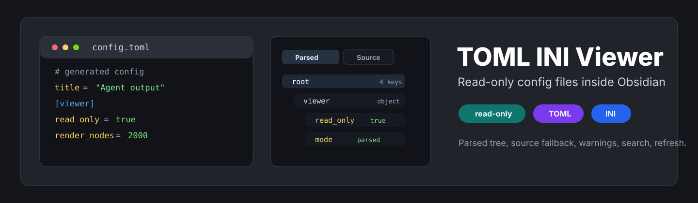
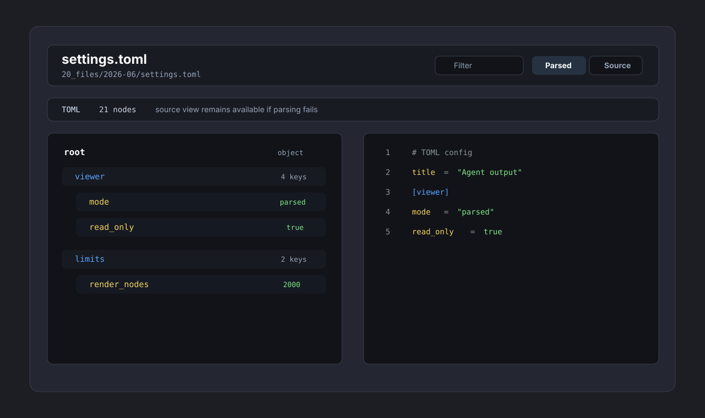

<p align="center">
  
</p>

<p align="center">
  <a href="https://github.com/viggomeesters/obsidian-toml-ini-viewer/releases/latest"></a>
  <a href="LICENSE"></a>
  
  
</p>

# TOML INI Viewer

TOML INI Viewer opens `.toml` and `.ini` files in Obsidian as a read-only config tree with search, source view, parse warnings, and safe large-file caps.

It is built for generated config, agent output, CLI settings, project scaffolds, and other small structured files that are not better served by YAML, JSON, HTML, CSV, or TSV viewers.



## Features

- Opens `.toml` and `.ini` files directly from Obsidian's file explorer.
- Shows a parsed config tree with sections, keys, values, type labels, and filtering.
- Provides a source view with line numbers and lightweight highlighting for comments, section headers, keys, separators, and values.
- Reports TOML parse errors without blocking access to the raw source.
- Reports INI duplicate keys, duplicate sections, malformed lines, and other ambiguous input as warnings.
- Caps rendered config nodes to keep Obsidian responsive on generated or oversized files.
- Refreshes the file after external changes.

## Why Read-Only?

TOML and INI files often rely on comments, ordering, whitespace, and tool-specific conventions. A form editor or formatter can easily remove comments, reorder sections, or normalize syntax in ways that change the intent of a config file.

TOML INI Viewer intentionally does not write to disk, so it cannot reformat or corrupt source-of-truth configuration files.

## Parser Model

- TOML uses [`smol-toml`](https://github.com/squirrelchat/smol-toml), a small parser dependency.
- INI uses a local conservative parser because INI is not one strict standard. Duplicate keys, duplicate sections, and malformed lines are shown as warnings rather than hidden.

The source view is always available. If parsing fails, the raw file remains readable.

## Installation

### Manual

1. Download `main.js`, `manifest.json`, and `styles.css` from a release.
2. Create this folder in your vault:

```text
.obsidian/plugins/toml-ini-viewer/
```

3. Place the three release files in that folder.
4. Enable "TOML INI Viewer" in Obsidian community plugins.

### Development

```bash
npm install
npm run typecheck
npm test
npm run build
```

## Usage

Open a `.toml` or `.ini` file from the Obsidian file explorer. Use the toolbar to:

- filter the parsed tree
- switch between parsed and source views
- refresh after external file changes

## Limits

The parsed tree renders the first 2,000 config nodes. Additional nodes are counted and reported as a warning. Source view remains available for the full file.

## Release Checklist

```bash
npm run typecheck
npm test
npm run build
git tag 0.1.0
```

Release assets:

- `main.js`
- `manifest.json`
- `styles.css`
